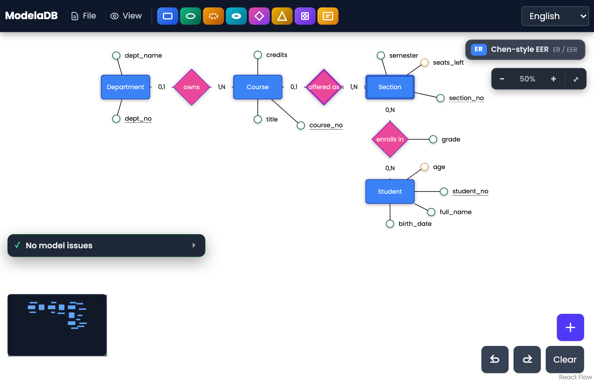

# ModelaDB

ModelaDB is a browser-based editor for entity-relationship (ER) and extended ER (EER) diagrams. It draws
Chen-style and Crow's Foot notations, checks the model against a set of validation rules, and generates
relational schemas and framework code from it. It runs in the browser: models are kept in `localStorage`
or in `.merdb` files saved locally, and no data leaves the page.

Live version: pending (the public URL will be added once the repository is published).

Scope and intended users: conceptual database modelling for people who teach, learn or practise ER/EER
design and want a free editor that also produces DDL. This repository documents what the software does and
how it was checked; it makes no claim about learning or usability benefits.



## Features

- Constructs: entities (strong and weak), attributes (key, partial key, composite, derived, multivalued),
  relationships (binary, ternary, recursive, with attributes and roles), `(min,max)` cardinalities,
  specialization/generalization (`T,D`, `T,C`, `P,D`, `P,C`), categories (union), aggregation, post-it notes.
- Two notations over one model: Chen-style EER and Crow's Foot (see [docs/NOTATION.md](docs/NOTATION.md)).
- Validation rules R001–R012, C001 (Chen-style EER) and CF001 (Crow's Foot), shown live in a panel.
- Code generation: PostgreSQL, MySQL, MariaDB, SQLite DDL; Laravel migrations, Prisma, Django, GraphQL SDL,
  JSON Schema; the canonical MerDB-IR.
- Reverse engineering of `CREATE TABLE` statements into a model.
- Undo/redo, autosave, `.merdb` files (JSON), PNG/SVG/PDF export, Portuguese and English interface.
- Optional research build (`VITE_RESEARCH_MODE=true`) that records a local interaction log in saved files; the
  default build collects nothing and makes no network requests.

## Run locally

Requires Node `^20.19.0 || >=22.12.0`.

```bash
npm ci
npm run dev        # development server
npm run build      # production build in dist/
npm run preview    # serve dist/
```

## Test and evaluate

```bash
npm run lint
npm test                    # unit tests (Vitest)
npm run test:coverage       # with coverage
npm run test:e2e            # Playwright, headless, against the production build
                            # first time: npx playwright install chromium  (or E2E_CHANNEL=chrome)
npm run test:e2e:coverage   # V8 coverage of src/app.js, reported separately from Vitest coverage
npm run evaluate            # needs Docker; writes evaluation/results/
npm run figures             # regenerates the five screenshots in evaluation/figures/
```

`npm run evaluate` runs DDL generated for 14 original corpus models on PostgreSQL 16, MySQL 8.4,
MariaDB 11.8 and SQLite, compares the resulting schemas with hand-written oracles and key/foreign-key
behaviour tests, checks ORM and schema targets with Prisma, Django, Laravel (`illuminate/database`), GraphQL
and Ajv in pinned containers, runs a mutation experiment on the validation rules, tests a SQL-to-model-to-SQL
round trip, and measures timings. See [evaluation/README.md](evaluation/README.md) for the method, results
and threats to validity. Container images are pinned by digest in `evaluation/images.lock.json`.

## Usage walkthrough

1. Drag *Entity* from the toolbar onto the canvas and double-click to rename it.
2. Drag *Attribute* onto the entity; click or right-click it -> *Set Key*.
3. Add a second entity and a *Rel.*; Ctrl/Cmd+click an entity and the relationship, press `C` to connect;
   double-click the connection label to edit `min,max`.
4. Read the validation panel (bottom left) and fix what it reports.
5. *File -> Export code* -> choose a target -> *Download File* or *Copy*.

See [docs/USER_GUIDE.md](docs/USER_GUIDE.md) and [docs/INTERACTION.md](docs/INTERACTION.md) for details.

## Documentation

- Notation, cardinality semantics, and relation to Chen (1976) and later EER conventions: [docs/NOTATION.md](docs/NOTATION.md).
- Code structure and mapping rules: [docs/ARCHITECTURE.md](docs/ARCHITECTURE.md).
- Pointer, touch and keyboard interaction contract: [docs/INTERACTION.md](docs/INTERACTION.md).

## File format

`.merdb` is JSON with `version`, `meta`, `domain` and `view`. Schemas: `schemas/merdb-v2.schema.json` (file) and
`schemas/merdb-ir.schema.json` (canonical export). Files from earlier versions open and are saved in the
current format. Schema identifiers derive from `https://github.com/williancomp/modeladb-ufmt-app`; override with
`VITE_MODELADB_BASE_URL` at build time.

## Research mode and privacy

By default nothing is collected and nothing is sent anywhere. A build with `VITE_RESEARCH_MODE=true` asks for a
participant name (kept in `sessionStorage`) and records an interaction log that is embedded in files the user
saves; it is not transmitted over the network.

## Known limitations

- Generated ORM code: Django has no composite foreign keys, so such columns are plain fields with a comment;
  Laravel output concatenates one migration class per table in a single file (it must be split into files).
- Reverse engineering recovers tables, columns, keys and foreign keys, but not CHECK, DEFAULT, indexes,
  referential actions (the exporter writes `ON DELETE CASCADE` everywhere), UNIQUE on non-key columns,
  specializations, categories, aggregations, composite/derived/multivalued attributes or role names
  (`evaluation/results/roundtrip_*.csv`).
- Notation-specific limits (three-vertex specialization triangles, relationships to aggregations, and arbitrary
  cardinality bounds `min,max` beyond `0,1`/`1,1`/`0,N`/`1,N`) are documented in [docs/NOTATION.md](docs/NOTATION.md).
- Firefox is not supported. Windows, Firefox and real touch devices (phones, tablets, touch screens) have not
  been tested; the end-to-end suite runs in Chromium on macOS and Linux.
- The PostgreSQL, MySQL, MariaDB and SQLite results apply to the versions pinned in `evaluation/images.lock.json`
  and to the corpus and hand-written DDL in this repository; threats to validity for the rule-mutation experiment
  are in [evaluation/README.md](evaluation/README.md).

## Citation

See `CITATION.cff` (version 2.3.0, MIT, no DOI yet). Third-party components and fonts are listed in
[THIRD_PARTY_NOTICES.md](THIRD_PARTY_NOTICES.md).

## Author and support

Prof. Dr. Willian Garcias de Assunção, Federal University of Mato Grosso (UFMT), Department of Computing and
Technology. Support: [willian.assuncao@ufmt.br](mailto:willian.assuncao@ufmt.br).

## Licence

MIT, (c) 2026 Willian Garcias de Assunção. See [LICENSE](LICENSE).
